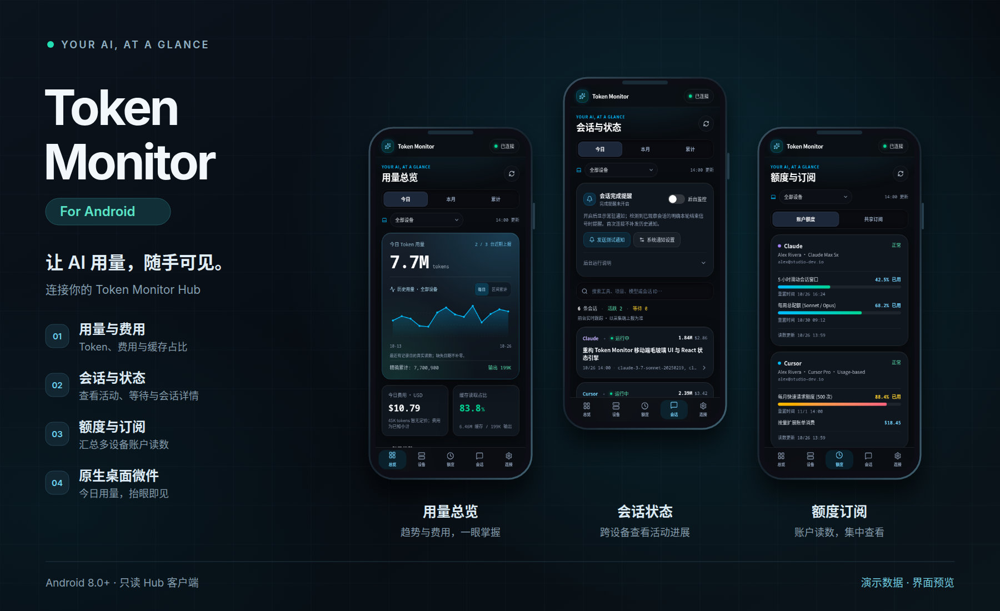
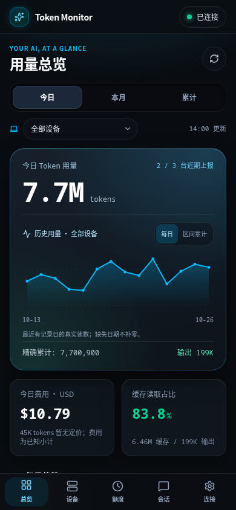
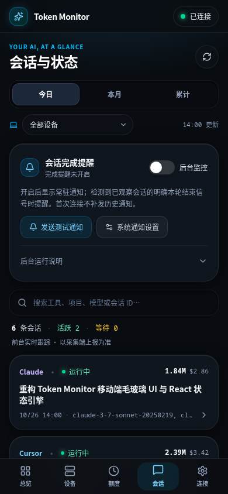
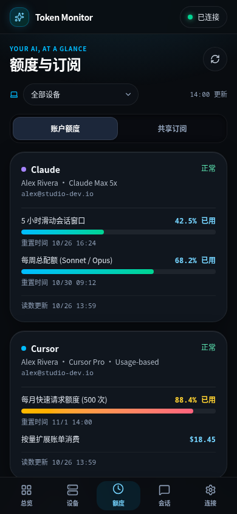
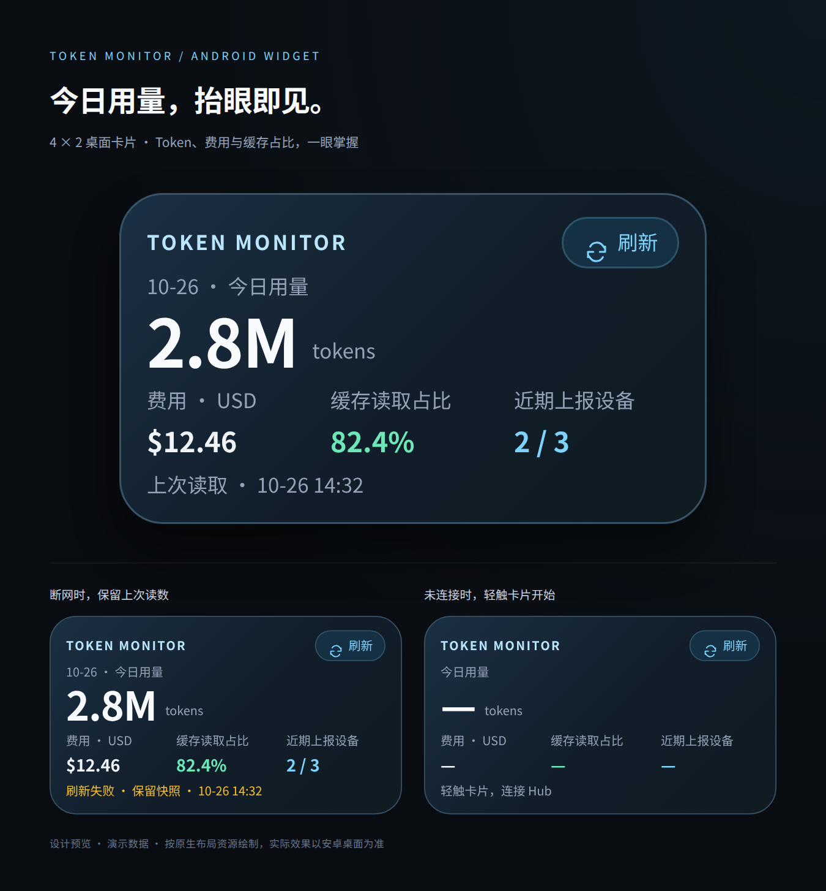

# Token Monitor for Android

在手机上查看 AI 编程工具的 Token 用量、费用、会话状态与账户额度。

[](https://github.com/AoXIUy/token-monitor-For-Android/actions/workflows/android.yml)


[](https://github.com/AoXIUy/token-monitor-For-Android/actions/workflows/release.yml)
[](LICENSE)



本项目是 [Token Monitor 主线](https://github.com/Javis603/token-monitor) 的 Android 只读客户端独立仓库。电脑上的桌面端或 Agent 负责采集，Hub 负责汇总，手机连接同一个 Hub 查看数据。Android 客户端支持 Node Hub 和 Cloudflare Worker Hub，不采集手机上其他应用的使用情况。

> 主线项目、桌面端、采集器及 Hub 部署说明请前往 **[Javis603/token-monitor](https://github.com/Javis603/token-monitor)**。本仓库保留原项目 MIT 许可，来源与共享代码维护方式见 [UPSTREAM.md](docs/UPSTREAM.md)。

## 可以做什么

| 功能 | 说明 |
| --- | --- |
| 用量总览 | 查看全部设备或单设备的今日、本月、累计 Token、费用、缓存及输出统计 |
| 历史趋势 | 展示 Hub 提供的每日记录，支持每日 / 区间累计和单日数值查看 |
| 会话与状态 | 搜索并按工具筛选，按最近、用量或费用排序，查看状态及所有来源设备；子代理保留完整分组和用量 |
| 会话详情 | 查看最近使用模型、完整模型组成、输入缓存命中率、推理强度、费用、来源设备与父子会话关系 |
| 会话实时速率 | Antigravity / Codex 的输出 tok/s、tok/min 与五分钟趋势；按来源快照增量计算，断线留空，累计均速单独标注 |
| 额度与余额 | 查看 Hark、Mistral 额度与 Qoder 独立个人 / 团队积分；区分 Muse 网页 / CLI、MiniMax Code / API 和 MiMo 产品；账户仍在电脑端管理 |
| 额度历史 | 点击展开本机观测的额度趋势和近 14 天净变化，支持 OpenDesign 工作区；缺失读数保持未知 |
| 完成提醒 | 主动开启后台监控后，对观察到的明确轮次结束发送通知 |
| 桌面微件 | 原生桌面卡片展示最近读取的今日 Token、费用和缓存读取占比，支持手动刷新 |
| 软件更新 | 启动时弹窗提示新版本，支持应用内下载、完整性与签名校验及系统确认安装 |

### 界面预览

<p align="center">
  
  
  
</p>

更多预览：[设备](docs/screenshots/devices.png) · [会话详情](docs/screenshots/session-detail.png) · [连接设置](docs/screenshots/settings.png)



展示图及截图均使用演示数据；实际内容取决于 Hub 和采集端提供的字段。

1.1.0 同步主线 v0.84/v0.85 的 Android 适配：工具筛选在搜索结果内生效，匹配组内任一工具时保留整个会话家族；来源标签列出当前周期内实际持有记录的所有设备。设备硬件图标使用 Hub 上报信息，旧 Hub 保留通用图标。模型组成明确显示已观测覆盖范围，其余组成保持未知；提示缓存估计仅用于 Claude。

[1.1.0 工具筛选与来源设备预览](docs/screenshots/sessions-1.1.0.jpg)：生产 React 包与演示原生桥接的浏览器截图，不代表真机验收。

1.4.0 适配上游主线 v0.86 / OpenDesign 及手机本地额度历史，范围和验证限制见 [适配记录](docs/upstream-0.86.md)，更新内容见 [发布说明](docs/releases/1.4.0.md)。

1.5.0 增量适配 [上游 v0.87 主线](docs/upstream-0.87.md)，包含 MiniMax 产品分离、已验证账户分组、现金消费周期、视频次数及无限额展示，更新内容见 [发布说明](docs/releases/1.5.0.md)。

1.6.0 适配 [主线 v0.88 / `eb8cf9d`](docs/upstream-0.88.md)：新增 Gemini CLI、Mistral Vibe、Prime Agent、Jcode 的工具展示，Mistral 额度、MiMo 余额组成，以及兼容来源反复接管后的额度历史，更新内容见 [发布说明](docs/releases/1.6.0.md)。

1.11.0 优化核心额度速览：优先展示已采集的有效读数，标识历史读数，补充消费与余额展示，支持展开全部已采集账户。详见 [发布说明](docs/releases/1.11.0.md)。

1.10.0 扩展总览：新增会话、额度和设备贡献速览，支持下钻查看；趋势曲线、日期柱体与每日明细联动，用量分布支持搜索、费用排序及展开全部。详见 [发布说明](docs/releases/1.10.0.md)。

1.9.0 优化会话浏览：快捷进入对话与详情，支持对话搜索和同条续文合并；工具与上下文事件聚合后按需展开，新增会话排序与紧凑的完成提醒设置。详见 [发布说明](docs/releases/1.9.0.md)。

1.8.0 新增 [Antigravity / Codex 在线对话与上下文](docs/SESSION_CONVERSATIONS.md)：点击时从在线来源设备分页查询，Hub 不持久化正文。需要同步更新本分支的 Node Hub 与采集端，开启方式见该指南；[发布说明](docs/releases/1.8.0.md)。

1.7.0 适配 [主线 v0.89 / v0.90 / `82e0051`](docs/upstream-0.90.md)：Hark 额度、Qoder 个人 / 团队积分、最近模型、输入缓存命中率与会话缓存明细，以及累计活跃天数的完整性校验，更新内容见 [发布说明](docs/releases/1.7.0.md)。

## 安装与连接

需要 Android 8.0（API 26）及以上版本，并将系统 Android WebView 更新至 Chromium 111 或以上。

1. 在 [主线项目](https://github.com/Javis603/token-monitor) 的桌面端启用 Hub，或部署 Node / Cloudflare Hub，并让电脑端持续上传数据。
2. 从本仓库 [Releases](https://github.com/AoXIUy/token-monitor-For-Android/releases/latest) 下载正式签名 APK 安装；可用附带的 `SHA256SUMS` 校验文件。开发调试包仍可从 [GitHub Actions](https://github.com/AoXIUy/token-monitor-For-Android/actions/workflows/android.yml) 的成功运行下载，也可按下文自行构建。
3. 在 App 的「连接」页填写 Hub 根地址和 shared secret，例如 `https://monitor.example.com` 或 `http://192.168.1.10:17321`。
4. 局域网 HTTP 需要显式打开「允许 HTTP」。HTTP 会明文传输凭据，跨网络连接应使用有效 HTTPS 或已有 VPN。

手机上的 `localhost` 指手机自身；Android 模拟器访问宿主机可使用 `10.0.2.2`。支持反向代理路径前缀；Hub 地址不接受内嵌用户名、密码、查询参数或片段。

前台界面每 5 秒读取 Hub，进入后台后暂停界面轮询；断线后保留上次读数并显示更新时间。状态的新鲜程度取决于电脑端上传频率，过期数据会标记为未知或已过期。

完成提醒可在「会话」或「连接」页开启，需要通知权限并显示常驻通知。首次快照只建立基线，空闲、消失或推断活动不会被当作完成。Android 后台预算、省电策略和网络可能暂停或延迟监控；详细行为与验收步骤见 [开发指南](docs/DEVELOPMENT.md)。

长按系统桌面 → 微件 → **Token Monitor · 今日用量** 可添加桌面卡片。微件显示带日期与时间的快照，系统约每 30 分钟请求刷新，实际执行可能延后；也可点击卡片右上角手动刷新。

「连接」页的「软件更新」显示实际安装版本。自动检查默认开启，启动应用时检查新版本并弹窗展示说明，可选择“下载并安装”或“稍后再说”；普通前后台切换沿用 12 小时间隔，也可关闭自动检查后手动检查。更新提示独立于 Hub 连接，关闭提示后仍可在设置页继续更新。

安装包由 App 内下载，支持进度、取消和失败重试。下载后校验大小、SHA-256、包名、版本和原有正式签名，校验失败会阻止安装。首次安装更新时，系统可能要求允许 Token Monitor 安装应用；授权返回后会重新校验，再打开系统安装器由你确认。下载文件保存在应用私有目录，不需要存储权限；应用重建会取消未完成的下载，已完成的包可在复核后继续安装。详见 [更新流程与验证](docs/UPDATES.md)。

## 从源码构建

环境要求：**JDK 17、Node.js 22.15+、Android SDK Platform 36、Build Tools 35.0.0**。工程使用 Gradle Wrapper 8.13 和 Android Gradle Plugin 8.13.2。

```bash
git clone https://github.com/AoXIUy/token-monitor-For-Android.git
cd token-monitor-For-Android
npm ci --prefix ui
```

在 Android Studio 中直接打开仓库根目录，设置 JDK 17 并安装对应 SDK。Android Studio 的环境中也需要能够运行 Node.js 和 npm。

macOS / Linux：

```bash
sh ./gradlew assembleDebug lint
```

Windows PowerShell：

```powershell
.\gradlew.bat assembleDebug lint
```

Gradle 会先校验 TypeScript 并构建 React 界面。Debug APK 输出到 `app/build/outputs/apk/debug/app-debug.apk`，使用 Android 默认调试签名。正式签名与 Release 构建见 [开发指南](docs/DEVELOPMENT.md#正式签名)。

## 开发与验证

```bash
npm run verify                 # Node 展示/状态测试、Java 校验、React 类型检查和构建
npm run dev --prefix ui         # 仅本地界面开发预览
sh ./gradlew assembleDebug assembleDebugAndroidTest lint
sh ./gradlew connectedDebugAndroidTest  # 需要专用模拟器或测试设备
```

浏览器预览使用演示数据和模拟交互，不能替代 Android 原生 WebView、Keystore、通知和微件验收。仪器测试会清空测试设备中本 App 的连接配置。GitHub CI 配置见 [android.yml](.github/workflows/android.yml)。[Release 工作流](.github/workflows/release.yml) 在推送版本标签或手动触发后，先复用完整 CI，通过后正式签名并发布；配置与后续版本发布步骤见 [Actions 发布指南](docs/RELEASING.md)。

工程以 Java 原生层处理网络、加密存储、通知和微件，React + TypeScript 在本地 WebView 中展示界面；运行时不依赖 CDN 或远程字体。源码与边界约定见 [开发指南](docs/DEVELOPMENT.md)。

后续功能的现状对照、优先级、工作量和验收条件见 [新增功能与改进开发计划书](docs/plans/2026-11-04-feature-development-plan.md)；该计划为评审建议，未实现功能以文中标注为准。

## 数据与隐私

- Hub 连接仅调用允许的 GET 接口，不注册采集设备、不上传用量、不修改订阅、不删除设备。软件更新独立读取固定仓库的 GitHub 公开 Release 接口，不向它发送 Hub 凭据或统计。
- shared secret 由原生层通过 Android Keystore 的 AES-GCM 密钥加密保存，已有凭据不返回网页；更换地址需要重新输入 secret。
- WebView 仅加载 APK 中允许的本地资源，页面不直接访问网络；原生请求使用系统 TLS 校验并拒绝重定向。
- 不持久化完整统计快照或对话正文；提醒去重和微件只保存必要的有界摘要，应用禁用云备份。
- 额度历史只在本机保存散列账户 / 工作区身份、数值、时间和日汇总，不保存账户名称、邮箱或凭据，不上传 Hub；明细保留 180 个本地日，日汇总保留 730 个本地日。

## 致谢与许可

感谢 **[Javis603/token-monitor](https://github.com/Javis603/token-monitor)** 提供主线项目、Hub 协议与共享计算模块。本仓库聚焦 Android 客户端，桌面采集与服务端功能请参阅主线。

遵循 [MIT License](LICENSE)，保留原作者版权声明。
