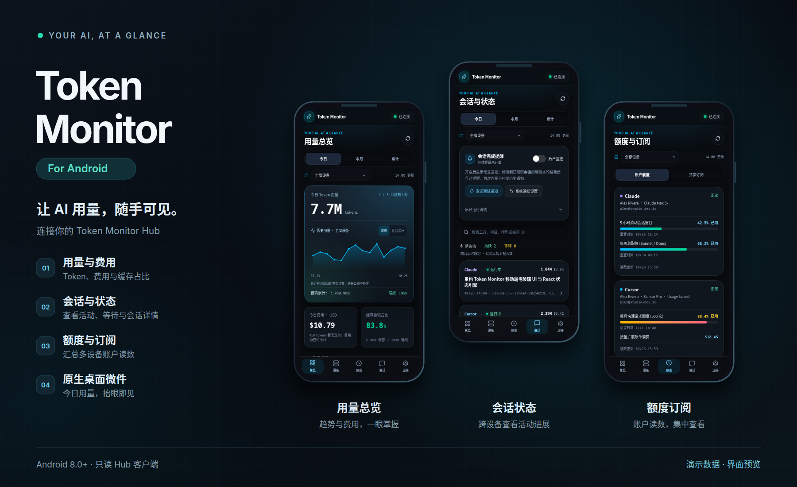
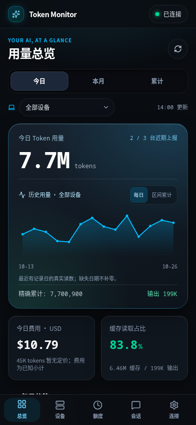
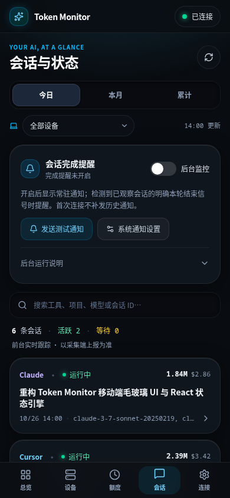
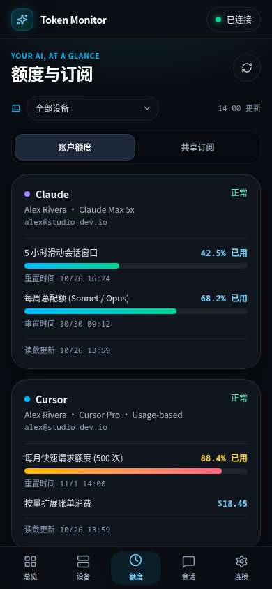
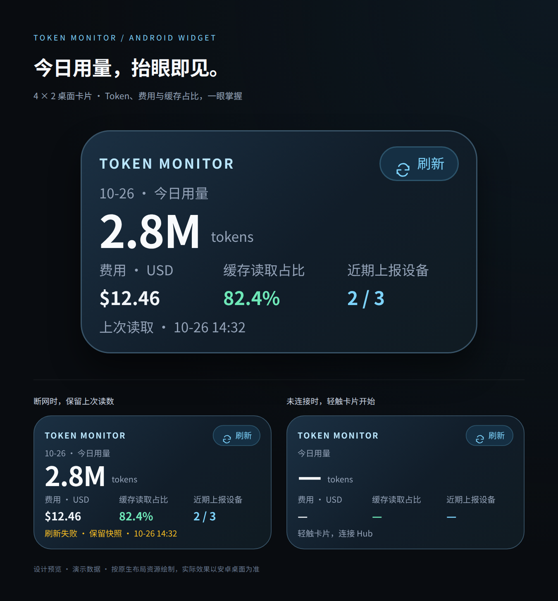

# Token Monitor for Android

在手机上查看 AI 编程工具的 Token 用量、费用、会话状态与账户额度。

[](https://github.com/AoXIUy/token-monitor-For-Android/actions/workflows/android.yml)


[](LICENSE)



本项目是 [Token Monitor 主线](https://github.com/Javis603/token-monitor) 的 Android 只读客户端独立仓库。电脑上的桌面端或 Agent 负责采集，Hub 负责汇总，手机连接同一个 Hub 查看数据。Android 客户端支持 Node Hub 和 Cloudflare Worker Hub，不采集手机上其他应用的使用情况。

> 主线项目、桌面端、采集器及 Hub 部署说明请前往 **[Javis603/token-monitor](https://github.com/Javis603/token-monitor)**。本仓库保留原项目 MIT 许可，来源与共享代码维护方式见 [UPSTREAM.md](docs/UPSTREAM.md)。

## 可以做什么

| 功能 | 说明 |
| --- | --- |
| 用量总览 | 查看全部设备或单设备的今日、本月、累计 Token、费用、缓存及输出统计 |
| 历史趋势 | 展示 Hub 提供的每日记录，支持每日 / 区间累计和单日数值查看 |
| 会话与状态 | 搜索会话，查看运行、等待、已结束等状态及来源；子代理按明确关系分组 |
| 会话详情 | 查看 Token 组成、费用、模型、来源设备、上下文快照和父子会话关系 |
| 额度与余额 | 查看 Hub 同步的账户额度、余额及共享订阅；账户仍在电脑端管理 |
| 完成提醒 | 主动开启后台监控后，对观察到的明确轮次结束发送通知 |
| 桌面微件 | 原生桌面卡片展示最近读取的今日 Token、费用和缓存读取占比，支持手动刷新 |

### 界面预览

<p align="center">
  
  
  
</p>

更多预览：[设备](docs/screenshots/devices.png) · [会话详情](docs/screenshots/session-detail.png) · [连接设置](docs/screenshots/settings.png)



展示图及截图均使用演示数据；实际内容取决于 Hub 和采集端提供的字段。

## 安装与连接

需要 Android 8.0（API 26）及以上版本，并将系统 Android WebView 更新至 Chromium 111 或以上。

1. 在 [主线项目](https://github.com/Javis603/token-monitor) 的桌面端启用 Hub，或部署 Node / Cloudflare Hub，并让电脑端持续上传数据。
2. 从本仓库 [GitHub Actions](https://github.com/AoXIUy/token-monitor-For-Android/actions/workflows/android.yml) 的成功运行中下载 `Token-Monitor-Android-debug` 产物，解压后安装 APK；也可按下文自行构建。下载 Actions 产物需要登录 GitHub。
3. 在 App 的「连接」页填写 Hub 根地址和 shared secret，例如 `https://monitor.example.com` 或 `http://192.168.1.10:17321`。
4. 局域网 HTTP 需要显式打开「允许 HTTP」。HTTP 会明文传输凭据，跨网络连接应使用有效 HTTPS 或已有 VPN。

手机上的 `localhost` 指手机自身；Android 模拟器访问宿主机可使用 `10.0.2.2`。支持反向代理路径前缀；Hub 地址不接受内嵌用户名、密码、查询参数或片段。

前台界面每 5 秒读取 Hub，进入后台后暂停界面轮询；断线后保留上次读数并显示更新时间。状态的新鲜程度取决于电脑端上传频率，过期数据会标记为未知或已过期。

完成提醒可在「会话」或「连接」页开启，需要通知权限并显示常驻通知。首次快照只建立基线，空闲、消失或推断活动不会被当作完成。Android 后台预算、省电策略和网络可能暂停或延迟监控；详细行为与验收步骤见 [开发指南](docs/DEVELOPMENT.md)。

长按系统桌面 → 微件 → **Token Monitor · 今日用量** 可添加桌面卡片。微件显示带日期与时间的快照，系统约每 30 分钟请求刷新，实际执行可能延后；也可点击卡片右上角手动刷新。

## 从源码构建

环境要求：**JDK 17、Node.js 22.15+、Android SDK Platform 36、Build Tools 35.0.0**。工程使用 Gradle Wrapper 8.13 和 Android Gradle Plugin 8.13.2。

```bash
git clone https://github.com/AoXIUy/token-monitor-For-Android.git
cd token-monitor-For-Android
npm ci --prefix ui
```

在 Android Studio 中直接打开仓库根目录，设置 JDK 17 并安装对应 SDK。Android Studio 的环境中也需要能够运行 Node.js 和 npm。

macOS / Linux：

```bash
sh ./gradlew assembleDebug lint
```

Windows PowerShell：

```powershell
.\gradlew.bat assembleDebug lint
```

Gradle 会先校验 TypeScript 并构建 React 界面。Debug APK 输出到 `app/build/outputs/apk/debug/app-debug.apk`，使用 Android 默认调试签名。正式签名与 Release 构建见 [开发指南](docs/DEVELOPMENT.md#正式签名)。

## 开发与验证

```bash
npm run verify                 # Node 展示/状态测试、Java 校验、React 类型检查和构建
npm run dev --prefix ui         # 仅本地界面开发预览
sh ./gradlew assembleDebug assembleDebugAndroidTest lint
sh ./gradlew connectedDebugAndroidTest  # 需要专用模拟器或测试设备
```

浏览器预览不会自动伪造 Hub 连接，也不能替代 Android 原生 WebView、Keystore、通知和微件验收。仪器测试会清空测试设备中本 App 的连接配置。GitHub CI 配置见 [android.yml](.github/workflows/android.yml)。

工程以 Java 原生层处理网络、加密存储、通知和微件，React + TypeScript 在本地 WebView 中展示界面；运行时不依赖 CDN 或远程字体。源码与边界约定见 [开发指南](docs/DEVELOPMENT.md)。

## 数据与隐私

- 仅调用允许的 Hub GET 接口，不注册采集设备、不上传用量、不修改订阅、不删除设备。
- shared secret 由原生层通过 Android Keystore 的 AES-GCM 密钥加密保存，已有凭据不返回网页；更换地址需要重新输入 secret。
- WebView 仅加载 APK 中允许的本地资源，页面不直接访问网络；原生请求使用系统 TLS 校验并拒绝重定向。
- 不持久化完整统计快照或对话正文；提醒去重和微件只保存必要的有界摘要，应用禁用云备份。

## 致谢与许可

感谢 **[Javis603/token-monitor](https://github.com/Javis603/token-monitor)** 提供主线项目、Hub 协议与共享计算模块。本仓库聚焦 Android 客户端，桌面采集与服务端功能请参阅主线。

遵循 [MIT License](LICENSE)，保留原作者版权声明。
