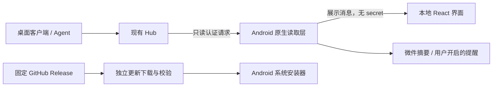

# Android 客户端新增功能与改进开发计划书

编制日期：2026-11-04（Asia/Shanghai）。状态：供评审和拆分 Issue 的建议稿。分析基线：Android `1.3.0 / versionCode 14`，提交 `d3b9fb7b584a16d7e0ccfba6b49d8c2a8d77d7ba`。

建议继续采用 **Java 原生层 + React / TypeScript 本地 WebView**，围绕“手机查看、及时判断、可靠提醒”发展。首期先完善响应兼容和设备验收，再交付完整历史、日期范围、模型 / 项目下钻和手动导出；随后推进实时同步、额度提醒、多 Hub 配置。现有应用内更新、四类微件和完成提醒应继续改进，已有能力不作为从零开发的新需求。

本轮交付分析与计划文档，不包含业务功能开发、版本递增、提交推送或新 APK 发布。文中的工作量、性能指标和里程碑均为规划值。

## 1. 核验依据与结论

### 1.1 当前基线

| 对象 | 本次实际核验 | 对计划的影响 |
| --- | --- | --- |
| Android 本地源码 | 分支 `codex/fix-audit-findings`，分析开始时工作区干净，HEAD 为上述 `d3b9fb7` | 所有缺口按当前源码判断，不沿用旧版本的功能清单 |
| Android 远端 main | GitHub API 返回同一 `d3b9fb7` | 本地分析与本次核验的主分支一致 |
| Android 公开发布 | [v1.3.0](https://github.com/AoXIUy/token-monitor-For-Android/releases/tag/v1.3.0) 已公开，包含 APK、`SHA256SUMS`、`signature.txt`、`release-metadata.json` | 应用内下载与验签已经发布；不能重复列为待新增功能 |
| Android 发布流水线 | [Release Android 41764035122](https://github.com/AoXIUy/token-monitor-For-Android/actions/runs/41764035122) 成功；构建任务中的 WebView 模拟器仪器测试步骤成功 | 已有模拟器验收证据；正式签名覆盖升级、OEM 安装器与桌面体验仍需真机覆盖 |
| 上游最新正式版 | [v0.85.0](https://github.com/Javis603/token-monitor/releases/tag/v0.85.0)，本地来源记录已标明适配此版本 | 工具筛选、会话来源设备等能力已经适配，重点转向深度和可靠性 |
| 上游 main | [`6f01d38444aef68386b1e7ea7513467e2caf101b`](https://github.com/Javis603/token-monitor/commit/6f01d38444aef68386b1e7ea7513467e2caf101b) | 后续比较使用固定 SHA，避免评审时 main 漂移 |

上游从已适配的 `d7fd7db7` 到本次 main 只有两项提交：桌面窗口外观变更时保留窗口状态、释放缓存的出站代理连接。其改动集中于 Electron 和未被 Android 使用的 `outboundFetch.js`，本次未发现需要直接移植的 Android 变更。不能据此认为桌面全部功能已经在手机端实现。[比较记录](https://github.com/Javis603/token-monitor/compare/d7fd7db7...6f01d38444aef68386b1e7ea7513467e2caf101b)

共享代码追溯还需区分两种关系：`docs/upstream-files.json` 中 **6 / 6 SHA-256 匹配本地文件**；其中五个同路径文件的 Git blob 与本次上游 main 一致，`sessionGroups.js` 在上游树中没有同路径文件，属于来源工作区带入的可移植模块。后续同步应记录公开上游 SHA、原始路径和适配关系，不能把来源工作区 SHA 或六项校验通过等同于“六项均原样来自当前公开主线”。

### 1.2 产品与数据边界

上游提供桌面采集、Agent、Hub、工具额度解析、历史分析和多种桌面展示。本仓库定位为 **已有 Hub 的 Android 只读客户端**，不承担采集端与 Hub 的部署职责。[上游功能说明](https://github.com/Javis603/token-monitor/blob/6f01d38444aef68386b1e7ea7513467e2caf101b/README.md)

上游逐条 prompt / reply、工具调用等详情从采集设备的本地文件按需读取，未同步到 Hub；Android 当前的“会话详情”是同步统计摘要。完整对话正文、远程切换桌面账户、修改订阅、删除设备均不进入本计划首期。若以后需要这些能力，应另立跨仓库协议与授权方案，不能只增加手机页面。[会话字段与同步约定](https://github.com/Javis603/token-monitor/blob/6f01d38444aef68386b1e7ea7513467e2caf101b/docs/API.md#get-apistats)



Hub 数据缺失、上游采集未开启、历史明细被截断、设备离线和手机未联网是不同状态。新增功能必须保留这些差异，不能统一补零或标为“已结束”。

## 2. 已实现能力与差距

| 领域 | 当前实现与代码证据 | 判断及下一步 |
| --- | --- | --- |
| 总览与统计周期 | 今日、本月、累计；全部 / 单设备；Token、费用、组成、缓存占比。[App](../../ui/src/App.tsx)、[OverviewView](../../ui/src/components/OverviewView.tsx) | 已实现。下一步增加有数据依据的固定日期范围 |
| 工具 / 模型 / 项目分布 | 三类榜单，最多显示 30 项，超出时明确提示；项目不完整时有说明。[OverviewView:49](../../ui/src/components/OverviewView.tsx#L49) | 部分实现。缺少完整列表、排序和关联下钻，不应写成“尚无模型 / 项目统计” |
| 历史趋势 | 读取 `historyPreview`，模型保留最近 14 个有记录日；支持每日、区间累计和每日数值列表，只显示全部设备历史。[model:266](../../app/src/main/assets/model.js#L266)、[HistoryChart](../../ui/src/components/HistoryChart.tsx) | 部分实现。尚无完整历史请求、7 / 30 日范围、按设备历史和工具 / 模型历史分析 |
| 设备 | 设备状态、平台、硬件图标、版本与用量；可切换设备看总览。[DevicesView](../../ui/src/components/DevicesView.tsx) | 已实现。可增加采集诊断和本地显示偏好；旧 Hub 没有硬件字段时仍使用通用图标 |
| 会话 | 搜索、工具 / 状态筛选、分页、父子与连续会话分组、多来源设备、用量和模型组成详情。[SessionsView](../../ui/src/components/SessionsView.tsx)、[SessionDetailView](../../ui/src/components/SessionDetailView.tsx) | 已实现。后续优化大列表及设备重建后的浏览位置；不承诺远程正文 |
| 状态真实性 | 活动租约、来源设备、读取新鲜度、明确结束标记；未知状态不计入已结束。[model](../../app/src/main/assets/model.js)、[SessionCompletionTracker](../../app/src/main/java/com/tokenmonitor/android/SessionCompletionTracker.java) | 保留现有语义，所有新传输与缓存须回归 |
| 额度与订阅 | 多账户、窗口、重置时间、余额 / 积分；共享订阅只读；已有 `subscriptionsUpdatedAt` 驱动的按需重读。[LimitsView](../../ui/src/components/LimitsView.tsx)、[MainActivity:267](../../app/src/main/java/com/tokenmonitor/android/MainActivity.java#L267) | 已实现。缺少可配置的额度阈值通知；订阅同步不重复立项 |
| 完成提醒 | 用户开启的前台服务、明确活动后完成、基线、持久化去重、通知跳转和停止入口。[SessionMonitorService](../../app/src/main/java/com/tokenmonitor/android/SessionMonitorService.java) | 已实现。重点是系统中断说明、耗电与多读取方协调，不承诺永久后台运行 |
| 桌面微件 | 今日、紧凑、多周期、额度四类，多个尺寸与响应式布局；共享刷新和摘要；约 30 分钟系统刷新。[UsageWidgetProvider](../../app/src/main/java/com/tokenmonitor/android/UsageWidgetProvider.java)、[开发约定](../DEVELOPMENT.md#桌面微件) | 已实现。可增加每个微件的显示配置和明确的更新时间，不能当实时监控面板 |
| 应用内更新 | 自动 / 手动检查、提示、进度、取消、重试、恢复完成包、元数据 / 哈希 / 身份 / 原签名校验、来源安装授权。[更新说明](../UPDATES.md) | 已实现。未完成任务随 Activity 销毁取消；跨重建持续下载与断点续传属于后续增强 |
| Hub 连接 | 单一加密连接；切换清理旧数据；前台 5 秒轮询、失败退避至 60 秒。[ConnectionStore](../../app/src/main/java/com/tokenmonitor/android/ConnectionStore.java)、[MainActivity:246](../../app/src/main/java/com/tokenmonitor/android/MainActivity.java#L246) | 可增加多 Hub 配置和原生 SSE；不同时合并多个 Hub，避免同一设备重复计量 |
| 离线 | 进程内保留最后读数；仅微件与去重持久化有界摘要，完整统计不落盘 | 可选的冷启动离线摘要应另行定义字段、期限和清除策略 |
| 导出 | 当前没有用户手动导出入口 | 可用现有统计与历史生成 CSV / JSON，不需要 Hub 写接口 |
| 显示与可访问性 | 中文深色界面、USD 用量费用、原币种余额、已有语义标签和减少动画样式；主内容与导航最大宽度 440 px | 后续补充系统主题、字号、宽屏和显示货币；不能把已有原币种余额改成美元 |

同日审计的 F01–F05 已在当前源码修复并随 1.3.0 发布，作为回归保护项保留，不再列为待修复缺陷。[审计修复记录](../audits/2026-11-04-remediation.md)

## 3. 接口可行性与上游依赖

当前 `ConnectionSpec.endpoint()` 只允许 `/api/stats`、`/api/subscriptions`。因此完整历史、健康信息和 SSE 都需要先扩展原生只读白名单与校验，不能由 WebView 直接请求，也不能通过网页传入任意路径或 URL。[ConnectionSpec:41](../../app/src/main/java/com/tokenmonitor/android/ConnectionSpec.java#L41)

| 计划能力 | 已存在的上游数据 / 接口 | 客户端实施范围与限制 |
| --- | --- | --- |
| 完整历史、热力图、工具 / 模型历史 | `GET /api/history` 的 `daily`、`monthly`、`summary`；`historyRevision` | 可独立实现；接口是聚合历史，不能从中推导单设备历史或项目历史 |
| 单设备历史与可信固定范围 | `GET /api/devices` 的设备记录、`historyAvailable`、保留的 `history`、`periodWindows.timeZone`；`deviceHistoryRevision` | 按需加载并与实时设备记录按身份连接；旧 Hub 缺字段时降级；现有接口未提供本计划所需的分页合同 |
| 模型 / 项目下钻 | 原生周期中的 `clientModels`、项目 `clients` / 可选 `models`、已有会话字段 | 缺少关联字段就显示不可用；不能按 Token 占比猜测模型组成 |
| 实时更新 | `GET /api/stats/stream`，初始 `snapshot`、后续事件及 30 秒心跳 | 首版使用完整快照兼容模式；原生解析，后台关闭页面流，失败回退轮询 |
| Hub / 采集诊断 | `GET /api/health` 的构建标识；统计设备内的 `clientHealth`、时间和采集能力 | 健康端点不能证明认证成功；`hubBuild` 是构建标识，不能当安全证明 |
| 阈值提醒、配置、导出 | 已有额度和统计 + 手机本地设置 | 无需新增 Hub 写接口；后台时效受用户选择与系统调度约束 |
| 逐条对话、远程账户操作 | 现有同步接口不提供所需完整正文 / 操作合同 | 跨仓库依赖，暂缓，不给出“仅改客户端即可完成”的估算 |

上述路由已核对 [Node Hub 实现](https://github.com/Javis603/token-monitor/blob/6f01d38444aef68386b1e7ea7513467e2caf101b/src/hub/server.js#L436) 和 [Worker 实现](https://github.com/Javis603/token-monitor/blob/6f01d38444aef68386b1e7ea7513467e2caf101b/worker/src/index.js#L484)。固定范围的可用性、设备时区和未知组成应对照 [上游范围计算](https://github.com/Javis603/token-monitor/blob/6f01d38444aef68386b1e7ea7513467e2caf101b/src/electron/renderer/fixedPeriodRanges.js)，不能只对 14 日预览做切片。

## 4. 工作包与优先级

P0 表示首期交付前必须完成的兼容与验收工作，不表示发现了新的严重漏洞；P1 表示主要用户收益；P2 表示后续增强。人日估算包含实现与针对性回归，不含等待硬件、上游修改或应用商店流程。

| ID | 优先级 | 工作包 | 主要负责角色 | 前置条件 | 工程人日 |
| --- | --- | --- | --- | --- | --- |
| Q01 | P0 | 响应兼容、能力判断与可恢复诊断 | Android + React | 当前基线 | 3–4 |
| Q02 | P0 | 已发布版本单调性门禁 | Android / CI | 公开发布记录可读取 | 2–3 |
| Q03 | P0 | 专用设备验收与性能基线 | Android + QA | 测试设备、隔离 Hub | 3–5 |
| F01 | P1 | 完整历史与固定日期范围 | Android + React | Q01；历史夹具 | 6–9 |
| F02 | P1 | 工具 / 模型 / 项目完整列表与下钻 | React | Q01；范围状态约定 | 4–6 |
| F03 | P1 | 读取协调、前台 SSE 与轮询回退 | Android | Q01、Q03 | 5–8 |
| F04 | P1 | 额度阈值通知与本地预算 | Android + React | Q01；窗口身份定义 | 4–6 |
| F05 | P1 | 多 Hub 配置与安全切换 | Android + React | Q01；读取代次统一 | 4–6 |
| F06 | P1 | 手动 CSV / JSON 导出 | Android + React | F01 的历史状态；可先交付快照导出 | 2–3 |
| F07 | P2 | 微件显示配置 | Android | F05 如需按 Hub 固定 | 3–5 |
| F08 | P2 | 可选冷启动离线摘要 | Android + React | Q01；缓存字段约定 | 2–4 |
| F09 | P2 | 可访问性、主题、宽屏与货币显示 | React + Android | Q03 基线 | 4–7 |
| F10 | P2 | 更新下载跨重建恢复与网络策略 | Android | Q03 更新验收 | 3–5 |
| Q04 | P2 | 上游差异报告与来源映射 | Android / CI | 公开上游 SHA 与适配映射 | 2–3 |

### Q01：响应兼容、能力判断与可恢复诊断

现有原生层检查 `periods` / `devices` 的顶层形状，前端统计消息主要按类型声明接收；当前未设置 React 页面错误边界。此项为防御性改进，本轮没有据此复现新的页面崩溃。

实施入口为 `HubClient`、`MainActivity`、`ui/src/nativeState.js`、`ui/src/types/monitor.ts`。拟增加轻量字段规范化和页面错误边界，保留总览、详情、额度的不同可用状态；诊断页显示最后读取时间、来源设备上报时间、Hub 旧版本 / 接口缺失、TLS / 认证 / 超时的可处理原因。

验收：畸形可选字段只影响对应模块；关键结构无效时保留上次有效读数并标明失效，连接设置始终可达；未知金额、未知组成、缺少历史与明确零值保持区别。`/api/health` 404 或缺少 `hubBuild` 不阻止旧 Hub 读取。日志和诊断导出不包含 secret、会话标题或原始响应。新增只读端点仍执行目的地绑定、系统 TLS、拒绝重定向、大小限制和迟到结果隔离。

### Q02：已发布版本单调性门禁

当前脚本校验本地版本一致、正整数 code、说明、来源提交和同名标签冲突，但没有自动比较全部已公开版本的 version / code。扩展 `scripts/release-metadata.js` 或拆出发布预检，在签名与发布前读取完整分页的正式 Release、元数据或对应标签源码，要求新版本和 code 都严格增加。

验收：更高名称但更低 code、遗漏后续分页、重复公开版本、远端读取失败均不能继续新发布；允许同一源提交的草稿恢复，并区分新发布与已完成发布。旧元数据缺失时只能采用明确的标签源码回退，不能按零处理。普通本地校验可离线运行，远端核验在 Actions 单独执行。沿用原始签名、标签、资产名和草稿上传流程，同步更新发布指南与合约测试。

### Q03：专用设备验收与性能基线

保留现有 API 35 模拟器门禁；为系统安装授权、正式签名覆盖升级、后台监控中断、不同 Launcher 微件建立真机用例和结果表。真实 Hub 联调用隔离配置及合成数据，不使用生产连接。

验收：至少覆盖当前可获得的 Android 8 / 12 / 13 / 15 / 16 设备或模拟器组合，逐项标记实测与未测；现代 WebView、200% 字号、旋转、键盘、横屏、通知拒绝 / 恢复、离线与跨日均有记录。不能把矩阵中未取得的硬件标为通过，也不能用调试签名冒充正式覆盖升级。

性能先记录统一样本：10 台设备、合计 3,000 条会话、370 日历史且响应不超过 4 MiB。选定并记录基准设备、WebView 和运行模式后测量。拟定目标为页面筛选 P95 ≤ 300 ms、统计解析与首次投影 ≤ 1 s；若基线不满足，先定位解析 / 分组 / 渲染瓶颈，再确认门禁值。本次没有测得这些性能结果。

### F01：完整历史与固定日期范围

用户路径为“总览 → 历史分析”，提供本周、近 7 日、近 30 日与日历选择；现有今日、本月、累计继续表示原生周期。首版完整历史提供每日 Token / 费用、工具 / 模型分布、按设备查看和数据覆盖说明；热力图在同一数据模型上增加。

原生按需读取 `/api/history` 和 `/api/devices`，历史依据 revision 失效，不随每次 5 秒统计轮询重复下载。拟新增历史状态模块与页面，扩展 `PeriodId` 前先定义原生周期和派生日期范围的区别。较大响应仍受上限保护，超限时给出可操作说明；当前没有服务端分页，不能假设能自动翻页取完。

验收重点：

- `historyAvailable: true` 和实际保留的历史同时成立才认定对应设备范围可用；部分设备无历史时显示已知小计及覆盖不足，不能宣称完整总量。
- 按上游来源设备日历和窗口处理跨时区、跨月、夏令时与离线设备；实时当日覆盖历史当日时替换相应设备日桶，不重复相加。
- 当前“最近 14 个有记录日”保留原标签；新“近 14 / 7 / 30 日”按日历取范围，缺失日与真实零日分别表达。
- 完整历史的工具 / 模型总量、已知组成和未分类余量可核对；不从汇总比例补齐缺失组成。
- 固定范围没有足够项目 / 会话数据时关闭这些下钻或显示不可用；不能拿本月会话冒充近 30 日完整会话。累计范围也不能补造上游未同步的 `allTime.sessions`。
- revision、设备身份、历史开关或连接变化使缓存失效；旧请求不能污染新设备 / 新 Hub。

### F02：工具 / 模型 / 项目完整列表与下钻

从当前榜单进入完整列表，支持搜索、Token / 已知费用排序和按需加载；继续保留前 30 项的快速总览。详情展示上游实际提供的工具、模型、项目与会话关联，并沿用当前设备和周期。

实施入口为 `OverviewView`、展示模型和导航状态，拟增加列表 / 详情组件。关联使用规范化后的上游标识及明确关系；相同标题、同名设备或模型显示别名不能自行成为去重依据。项目模型映射是可选字段，旧记录显示“模型组成未知”。会话详情截断、项目未采集或归属不全时保留覆盖说明，不要求明细小计伪装成总计。

验收：超过 30 项仍可访问；同值排序稳定；进入明细后返回保留查询和滚动位置；切换设备或周期不会继续显示旧详情；多模型、未知费用、免费费用、同名项目和父子会话不重复累计。已观测 `modelTokenComponents` 与未知余量仍独立显示。

### F03：读取协调、前台 SSE 与轮询回退

当前页面读取和完成监控服务各自可能按 5 秒请求统计。先抽取连接代次与读取协调，再在前台接入原生 SSE；保留微件的系统调度和独立 GitHub 更新通道。拟新增 `HubReadCoordinator` / `HubStatsStream`，名称仅用于拆分工作，不表示当前已有这些类。

首版不发送 v4 协商头，消费完整 `snapshot` / `stats`，避免同时引入 JSON Patch。若以后采用 v3 的 `freshness` 或 v4 增量协议，必须单独实现对应时钟与 revision 基线规则，禁止忽略续租事件或部分应用补丁。[上游 SSE 合同](https://github.com/Javis603/token-monitor/blob/6f01d38444aef68386b1e7ea7513467e2caf101b/docs/API.md)

验收：同一当前连接的前台读取与已开启监控可共享有效数据；空闲 SSE 只保留必要心跳，不能另外保持 5 秒完整轮询；流端点缺失、代理缓冲、断流时自动恢复有界退避轮询。逐行 UTF-8、多个 `data` 行、注释、分段字节、事件大小上限、心跳超时、取消与重连均有测试。页面退后台关闭页面流；未开启提醒时不能因此新建常驻服务。新传输不能通过刷新设备收件时间来延长会话的 30 秒活动租约；首次 / 长断线恢复继续只建立完成提醒基线。

### F04：额度阈值通知与本地预算

账户窗口可设置例如 80% / 95% / 耗尽提醒，Token / 费用预算由用户本地定义并明确标注“个人预算”；上游余额和金额消费窗口沿用各自单位，不将不同币种或积分相加。

复用已有额度投影和通知设施，拟增加独立告警策略。身份包含当前连接、账户边界及稳定的窗口机器标识；优先使用上游 `limitId` 等字段，不能只按显示标签合并。缺少可信身份或有效读数时暂停该告警并说明原因。去重仅持久化必要的匿名标识、阈值和周期边界。

验收：同一窗口一次越线只提醒一次；窗口明确重置后才重新建基线；认证失败、陈旧数据、首次快照、断线恢复和账户切换不产生伪越线；明确零余额继续视为耗尽。静音时段和关闭入口可用，通知权限拒绝时界面可恢复。后台提醒必须由用户主动开启，继续遵守现有前台服务预算与系统限制；系统微件刷新不承担实时额度通知。耗尽时间预测留待多次有效观测后再评估，不纳入首版承诺。

### F05：多 Hub 配置与安全切换

支持保存带本地名称的多个 Hub，任一时刻仅一个激活；首版不同时聚合多个 Hub。将现有单连接加密记录迁移为原生加密配置集合，旧版本数据可原子迁移，解密失败仍可重新连接。

实施入口为 `ConnectionStore`、`MainActivity`、连接设置与读取协调。切换时取消旧读取、清理页面 / 历史 / 微件状态，停止旧完成监控，并以新的连接代次接受结果。secret 始终不回传页面；地址变化要求明确绑定新的凭据，不能自动把旧 secret 发给新主机。应用更新状态仍独立保留。

验收：A / B Hub 同名设备或相同会话键不会串数据；快速切换、迟到响应、重启、删除激活配置和迁移中断均可恢复；若后续允许微件固定 Hub，需同时完成 F07 的持久化字段与隐私说明，不能依赖当前全局摘要直接实现。

### F06：手动 CSV / JSON 导出

从统计 / 历史页面导出当前选择范围。首版由系统文档保存流程写入用户选择的位置，不申请广泛存储权限；只导出工具 / 模型数值与明确的范围和生成时间，不默认包含账户标识、设备名称、项目名称、会话标题或 secret。

格式对照 [上游导出说明](https://github.com/Javis603/token-monitor/blob/6f01d38444aef68386b1e7ea7513467e2caf101b/docs/export.md)：保留 USD 原始费用、未定价和未分类语义。没有完整历史时允许仅导出快照并标记范围，不能把预览称为完整历史。若采用不同 JSON 结构，需记录 Android 导出 schema 版本，不能宣称无损兼容桌面导出。

验收：CSV 处理 UTF-8、引号、逗号、换行和表格公式前缀；未知值与零值可区分；JSON / CSV 总量一致，取消保存不影响统计；通过原生受限操作输出，网页不能指定任意本地路径。自动定时导出暂缓。

### P2 工作包的实施条件

| ID | 改进与验收条件 |
| --- | --- |
| F07 | 为已有四类微件增加主题、密度、费用隐藏等配置；如允许选设备 / 账户 / Hub，配置与摘要分开保存，评审最小标识及加密方式，并同步当前“不保存设备 / 账户标识摘要”的文档。跨尺寸、删除最后一个微件、配置失效和连接切换不得串数据 |
| F08 | 用户可选保存最多一份聚合离线摘要，建议上限 1 MiB、默认有效期 24 小时；不保存完整会话或账户明细。冷启动明确显示快照时间、过期与离线状态，不恢复“运行中”或触发完成 / 额度通知；支持立即清除。实施前更新数据持久化说明 |
| F09 | 先修复实际可读性问题，再增加系统浅 / 深主题、宽屏布局与显示货币；USD 原始值不变、余额保留原币种，换算需标明汇率来源与时间。200% 字号、TalkBack、触控目标、图表文本替代与减少动画验收；未测前不宣称现有字号警告全部消除 |
| F10 | 优先使同一进程内的下载跨页面 / 配置重建继续并可取消；网络策略、磁盘空间、孤儿文件清理有明确反馈。跨进程续传作为独立可选项，只有服务端范围响应和资产身份可验证时才复用部分文件，否则重新下载；恢复后仍执行完整哈希与签名校验。不得增加任意镜像或弱化固定仓库信任规则 |
| Q04 | 定期生成上游公开 SHA、已适配版本、文件映射和功能 / 协议变化报告；自动比较同路径源码，适配模块另标来源关系及回归。遇到本次两项桌面变更应输出“评估无需移植”，不能自动合入整个 Electron / Hub |

以上工作优先复用已有 React、AndroidX 和系统 API。当前不新增依赖；以后若确需引入图表、持久化或后台调度库，应先在对应 Issue / PR 说明必要性、包体与维护影响。

## 5. 推荐排期与交付顺序

估算假设：一名熟悉 Java 与 React 的开发，每周五个工作日，另有兼职 QA 支持；固定历史和 SSE 无需修改上游协议。以启动日为 T0，不预设发布日，也不提前占用下一版版本号。

| 里程碑 | 范围与工程人日 | 退出条件 |
| --- | --- | --- |
| M0：可靠基线 | Q01、Q02、Q03，合计 8–12 人日 | 可恢复错误、发布门禁、专用设备记录与性能基线；设备不足的缺口明确登记 |
| M1：分析能力首期 | F01、F02、F06，合计 12–18 人日 | 完整 / 不完整历史语义、固定范围、下钻与手动导出通过；新功能对旧 Hub 可降级 |
| M2：实时与提醒 | F03、F04，合计 9–14 人日 | SSE / 轮询切换、重复读取控制、阈值去重和系统中断用例通过 |
| M3：多环境与移动体验 | F05 为 4–6 人日；按用户反馈选择 F07–F10、Q04 | 每次只纳入有验收资源的增强，逐项交付 |

**建议首期立项范围为 M0 + M1：20–30 工程人日，另留约 20% 联调缓冲，单开发约 5–8 周。** M2 后续立项，不把所有 P1 / P2 都塞入首个版本。若更强调手机即时提醒，可在 M0 完成后先交付 F04，再继续 M1；F03 应在测得重复读取和流式收益后实施。

每个工作包独立 Issue，按“数据模型 / 原生读取 → 页面 → 回归 → 设备验收”拆成可评审提交。历史、SSE、多 Hub 不在同一个大 PR 同时改动。版本号在实际发布前按当时公开 Release 和 code 重新选择；兼容功能用 minor、兼容修复用 patch，文档更新不发 APK。

## 6. 验收与发布门禁

| 验收面 | 必须验证的结果 |
| --- | --- |
| 协议兼容 | 当前上游、缺少新增字段的旧 Hub、Node / Worker 归一化夹具、字段缺失 / null / 0 / 畸形输入分别有预期 |
| 日期与范围 | 来源设备时区、跨日 / 月、夏令时、稀疏历史、未来日期、历史关闭、当日实时覆盖和设备移除不重复统计 |
| 会话 | 同名不合并、连续身份 / 父子关系不丢账、工具筛选保留家族、未知不算结束、设备与活动租约不过期续命 |
| 生命周期与网络 | 快速切换连接、后台 / 前台、配置重建、慢响应、认证失败、重定向、断流、超限、取消和迟到结果隔离 |
| 提醒与微件 | 权限拒绝 / 恢复、首次 / 长断线基线、重复事件、预算中断、不同 Launcher / 尺寸、手动刷新和跨日摘要 |
| 下载升级 | 原正式签名旧版覆盖升级；拒绝错包 / 错哈希 / 降 code / 异签名；授权返回、用户取消安装、低空间和重建恢复 |
| 显示与性能 | 200% 字号、TalkBack、键盘 / 系统栏 / 刘海、横竖屏、稳定排序、固定大样本基线与响应时间 |
| 隐私与只读边界 | secret 不进入网页、导出或日志；Hub 仍只读；新增持久化字段与文档一致；更新流量不携带 Hub 认证 |

测试使用固定时间与合成数据验证实际输出和状态变化；保留共享模块 CommonJS 与浏览器全局两种加载方式。可从固定 SHA 的上游生成脱敏合同夹具，但不将 Hub / Electron 打包进 Android 工程。仪器测试必须在专用设备运行，因为会清空本 App 的连接配置。

每个实际功能版本执行：

```bash
npm ci --prefix ui
npm run verify
node scripts/release-metadata.js
git diff --check
sh ./gradlew assembleDebug assembleDebugAndroidTest lint
sh ./gradlew connectedDebugAndroidTest
```

Android 构建使用 JDK 17、Platform 36、Build Tools 35.0.0。发布前还必须同步 `origin/main` 和 tags、核对公开 Releases、选择未使用且单调增加的版本 / code，按 [RELEASING.md](../RELEASING.md) 走一次发布路线。交付证据包括提交、标签、Actions、公开 Release、APK 元数据 / 哈希、原证书与 ZIP 对齐结果。不得移动旧标签或覆盖已公开资产。

## 7. 本次验证结果与未覆盖项

| 本次实际操作 | 结果 |
| --- | --- |
| 本地 / 远端基线、上游差异、公开 Release 与 Actions 状态 | 已核验，结果见第 1 节；读取远端状态，没有触发新流水线 |
| `npm run verify` | 通过：71 项 Node 测试、TypeScript 类型检查、Vite 生产构建；JDK 17 下 156 项 Java 检查 |
| `node scripts/release-metadata.js` | 通过，输出 `1.3.0 / 14 / v1.3.0`；本次本地命令不代替远端版本单调性核验 |
| 共享文件 SHA-256 | 本地来源清单 6 / 6 匹配；公开主线同路径 blob 对照结果见第 1 节 |
| 文档相对链接与 `git diff --check` | 通过 |
| 本地完整 Android 构建 / 设备仪器测试 | 本轮未重跑；没有修改应用代码。发布基线的云端模拟器成功记录与本地真机验收分别说明 |
| 实际公开 APK 下载、签名、安装器覆盖升级 | 本轮没有重新下载或安装；公开资产列表与成功流水线不冒充真机覆盖升级结果 |
| 所提新功能与性能目标 | 尚未开发 / 实测，必须按工作包退出条件验收 |

首次沙箱内 `npm run verify` 被发布测试的 `spawnSync git EPERM` 阻断；确认是测试在 `/tmp` 建临时仓库受限后，在允许本地子进程的环境使用同一命令重跑通过，没有为通过检查修改测试或业务代码。验证日志保留在 `/tmp/tokenmonitor-plan-verify.log`，关键结果已写入本文。

首个可实施批次为 Q01、Q02 与 Q03 的夹具 / 设备准备，随后推进 F01 的数据与日期合同。该顺序先建立可信的可用状态和验收依据，再扩展手机端分析能力。
